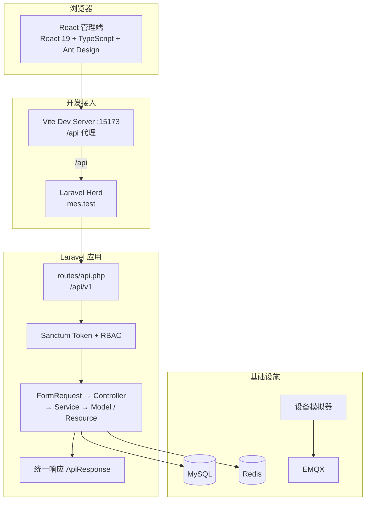
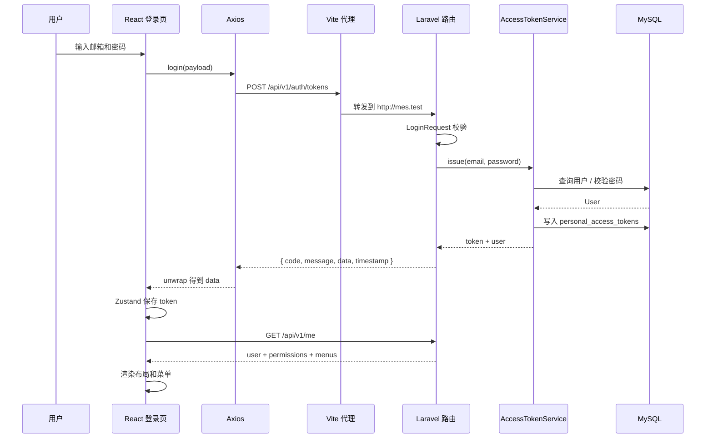

# MES MVP 入门教程：从 Docker Compose 到 Laravel API 与 React 管理端

这是一篇面向 Laravel 初学者的项目教程。

我们不会一上来讲完 MES 的所有业务，而是把项目能够跑起来、能够继续开发的三块底座讲透：

1. 用 Docker Compose 启动 MySQL、Redis、EMQX 和设备模拟器；
2. 用 Laravel 建立模块化 API、统一响应格式和 Token 认证；
3. 用 React + Vite + Ant Design 建立管理端、请求层和登录态。

学完这篇教程，你应该能够独立完成下面这条链路：

```text
浏览器登录
  → React 表单
  → Axios 请求层
  → Vite 代理
  → Laravel 路由
  → FormRequest 校验
  → Controller
  → Service
  → Eloquent / MySQL
  → 统一响应 JSON
  → React 保存 Token
  → 请求 /me
  → 左侧菜单和页面渲染
```

教程对应的项目代码位于本仓库，建议一边阅读一边打开对应文件。

> 为了便于阅读，教程中的示例会省略少量类型声明和注释；完整实现以仓库代码为准。

## 教程与三块任务

| 任务 | 对应章节 | 你会得到 |
| --- | --- | --- |
| 01 Compose 编排中间件与设备模拟器 | 第 1 章 | 能一条命令启动 MySQL、Redis、EMQX 和模拟器 |
| 02 后端骨架与统一响应契约 | 第 2 章 | 理解 Laravel 模块分层、统一 JSON、异常处理和 Token 登录 |
| 03 管理端骨架与请求层 | 第 3 章 | 理解 Vite 代理、Axios 拦截器、Zustand 登录态和路由守卫 |

## 适合谁

- 会一点 PHP，但还没有完整做过 Laravel 项目；
- 会一点 React 或 TypeScript，但还不清楚请求层、路由守卫和登录态怎么组织；
- 听说过 Docker、MQTT、Sanctum，但不知道它们在项目里各自解决什么问题；
- 想通过一个真实项目的“底座部分”理解前后端分离，而不是只看孤立语法。

## 学习目标

完成教程后，你应当能够回答这些问题：

- Docker Compose 的端口映射、数据卷、健康检查分别解决什么问题？
- Laravel 的 `FormRequest`、`Controller`、`Service`、`Model`、`Resource` 各自负责什么？
- 为什么要统一返回 `{ code, message, data, timestamp }`？
- Token 登录的完整链路是什么？Sanctum 在中间做了什么？
- 为什么前端开发时要配置 Vite 代理，而不是直接请求 `http://localhost:8000`？
- Axios 拦截器、Zustand、React Query 在登录态里分别承担什么职责？

## 0. 先看全局

### 0.1 三层结构



可以把项目理解成三层：

| 层 | 本项目中的位置 | 主要职责 |
| --- | --- | --- |
| 基础设施层 | `docker/`、`.env` | 提供数据库、缓存、消息队列和设备数据 |
| 后端应用层 | `app/`、`routes/` | 提供 REST API、认证、校验、业务逻辑和统一响应 |
| 前端应用层 | `frontend/web/` | 登录、路由、布局、请求封装和业务页面 |

### 0.2 一次请求怎么走

以“读取当前用户”为例：

1. 浏览器请求 `GET /api/v1/me`；
2. Vite 开发服务器把 `/api` 转发到 `http://mes.test`；
3. Laravel 根据 `routes/api.php` 找到 `/me`；
4. `auth:sanctum` 中间件检查 Bearer Token；
5. `active` 中间件检查用户是否被停用；
6. `MeController` 调用 `AccessControlService` 组装角色、权限和菜单；
7. `UserResource` 把模型转换成前端需要的字段；
8. `ApiResponse` 套上统一响应格式；
9. Axios 的 `unwrap` 把 `data` 取出来；
10. React Query 缓存结果，Zustand 保存用户信息，页面开始渲染。

### 0.3 目录地图

```text
app/
  Core/                 # 通用异常、OpenAPI、业务日期等基础能力
  Http/                 # 响应、中间件、通用控制器
  Modules/              # 按业务领域拆分的模块
    System/             # 认证、用户、角色、菜单、日志
    Organization/       # 工厂、车间、产线、班组、人员
    Product/            # 产品与版本
    Bom/                # BOM 与明细
    Process/            # 工序与工艺路线
    Production/         # 订单、任务、派工、报工、SN
    Quality/            # 检验标准、任务、记录、不良品
    Material/           # 物料、领料、退料
    Inventory/          # 库存与库存流水
    Equipment/          # 设备、设备数据、告警
    Dashboard/          # 驾驶舱聚合
    Traceability/       # 正向与反向追溯
routes/
  api.php               # /api/v1 路由
bootstrap/
  app.php               # 路由、中间件、异常处理入口
docker/
  docker-compose.yml    # 本地中间件编排
  simulator/            # MQTT 设备模拟器
frontend/web/
  src/api/              # Axios 请求层
  src/stores/           # Zustand 登录态
  src/router/           # 路由与权限守卫
  src/layouts/          # 管理端布局
  src/pages/            # 页面
```

> 说明：`app/Modules/BasicData` 是早期骨架留下的空目录。实际“基础数据”功能按领域拆在 `Organization`、`Product`、`Material`、`Bom`、`Process` 中，不要到空目录里找业务代码。

## 1. 用 Docker Compose 准备基础设施

### 1.1 为什么需要 Compose

MES 本地开发需要四类外部依赖：

| 依赖 | 用途 |
| --- | --- |
| MySQL 8.4 | 保存业务数据 |
| Redis 7 | Session、Cache、Queue |
| EMQX 5.8 | MQTT Broker，接收设备消息 |
| 设备模拟器 | 定时发布模拟设备数据 |

如果每个服务都手工安装、配置端口、创建用户，环境会很难复现。Docker Compose 用一份 YAML 描述所有服务，让团队成员用同一条命令得到同一套环境。

### 1.2 先理解三个 Compose 概念

**容器和镜像**

镜像是“安装包”，容器是“运行中的实例”。例如 `mysql:8.4` 是镜像，`mes-mysql-1` 是容器。

**端口映射**

```yaml
ports:
  - "127.0.0.1:13307:3306"
```

含义是：

```text
宿主机 127.0.0.1:13307  →  容器 3306
```

项目故意把宿主机端口换成 13307、16379、11883 这类高位端口，避免和本机已有的 MySQL、Redis、MQTT 冲突。

**数据卷**

```yaml
volumes:
  - mysql-data:/var/lib/mysql
```

数据卷让容器删除、重建后数据仍然保留。只有执行 `docker compose down -v` 才会连数据卷一起清理。

### 1.3 读一遍 compose 文件

核心文件是 `docker/docker-compose.yml`。它的结构如下：

```yaml
name: mes

services:
  mysql:
    image: mysql:8.4
    restart: unless-stopped
    ports:
      - "127.0.0.1:${DB_PORT:-13307}:3306"
    environment:
      MYSQL_DATABASE: ${DB_DATABASE:-mes}
      MYSQL_USER: ${DB_USERNAME:-mes}
      MYSQL_PASSWORD: ${DB_PASSWORD:-mes_secret}
      MYSQL_ROOT_PASSWORD: ${MYSQL_ROOT_PASSWORD:-root_secret}
    volumes:
      - mysql-data:/var/lib/mysql
```

这里有几个值得初学者记住的点：

- `${DB_PORT:-13307}` 表示“优先使用 `.env` 的 `DB_PORT`，没有就用 13307”；
- MySQL 容器内部仍然是标准的 3306，只有宿主机映射端口变了；
- MySQL 的库名、用户名、密码都从 `.env` 读取，Laravel 和 Compose 共用同一组变量；
- `healthcheck` 让 Compose 知道 MySQL 是否真的启动完成，而不是“容器进程刚起来”就继续。

Redis 和 EMQX 也是同样的结构：

```yaml
  redis:
    image: redis:7-alpine
    ports:
      - "127.0.0.1:${REDIS_PORT:-16379}:6379"

  emqx:
    image: emqx/emqx:5.8
    ports:
      - "127.0.0.1:${MQTT_PORT:-11883}:1883"
      - "127.0.0.1:${MQTT_WS_HOST_PORT:-11888}:8083"
      - "127.0.0.1:${EMQX_DASHBOARD_HOST_PORT:-18083}:18083"
```

设备模拟器稍微不同，它不直接暴露端口，而是等 EMQX 健康后开始发布消息：

```yaml
  simulator:
    build: ./simulator
    depends_on:
      emqx:
        condition: service_healthy
    environment:
      MQTT_HOST: emqx
      MQTT_PORT: 1883
      MQTT_FACTORY: ${MQTT_FACTORY:-F001}
      MQTT_DEVICES: ${MQTT_DEVICES:-EQ-SMT-01,EQ-REFLOW-01,EQ-CNC-01,EQ-ASM-01,EQ-TEST-01}
      MQTT_INTERVAL: ${MQTT_INTERVAL:-5}
```

注意这里 `MQTT_HOST` 写的是 `emqx`，不是 `127.0.0.1`。因为模拟器和 EMQX 都在 Docker 网络里，容器之间应该用 **服务名** 互访；只有宿主机上的 Laravel 才使用 `127.0.0.1:11883`。

### 1.4 设备模拟器在模拟什么

模拟器代码在 `docker/simulator/publish.py`，核心行为是：

1. 为每个设备维护运行状态；
2. 按概率在 `running / standby / fault / maintenance / offline` 之间切换；
3. 运行中的设备才增加累计产量；
4. 每次采样发布 `status` 和 `data` 消息；
5. 指标超过阈值时额外发布 `alarm` 消息。

主题格式固定为：

```text
mes/{factory}/{device}/status
mes/{factory}/{device}/data
mes/{factory}/{device}/alarm
```

例如：

```text
mes/F001/EQ-SMT-01/data
```

消息体包含：

```json
{
  "device_code": "EQ-SMT-01",
  "timestamp": "2026-11-18T02:30:00+00:00",
  "status": "running",
  "temperature": 57.3,
  "speed": 1120,
  "pressure": 0.71,
  "output": 128,
  "runtime_seconds": 3600
}
```

模拟器使用 QoS 1 发布，并等待 broker 确认。如果连接失败、发布失败或确认超时，进程会退出，Compose 的 `restart: unless-stopped` 会重新拉起它。这样比“静默失败但界面没有数据”更容易排查。

### 1.5 配置 `.env`

项目根目录的 `.env` 同时被 Laravel 和 Compose 读取。第一次配置可以先把 `.env.docker.example` 中方案 A 的变量合并到 `.env`。

方案 A：使用 Compose 自带的 MySQL。

```dotenv
APP_URL=http://mes.test

DB_CONNECTION=mysql
DB_HOST=127.0.0.1
DB_PORT=13307
DB_DATABASE=mes
DB_USERNAME=mes
DB_PASSWORD=change-me

MYSQL_ROOT_PASSWORD=root-change-me

REDIS_HOST=127.0.0.1
REDIS_PORT=16379
REDIS_PASSWORD=null

CACHE_STORE=redis
QUEUE_CONNECTION=redis
SESSION_DRIVER=redis

MQTT_HOST=127.0.0.1
MQTT_PORT=11883
MQTT_FACTORY=F001
```

方案 B：复用宿主机已有 MySQL。

只需要把 `DB_HOST` 和 `DB_PORT` 改成宿主机 MySQL 的地址，并跳过 Compose 里的 `mysql` 服务：

```bash
docker compose --env-file .env -f docker/docker-compose.yml up -d redis emqx simulator
```

无论哪种方案，修改 `.env` 后都建议执行：

```bash
php artisan config:clear
```

否则 Laravel 可能继续使用旧的配置缓存。

### 1.6 启动与验证

启动全部服务：

```bash
docker compose --env-file .env -f docker/docker-compose.yml up -d
```

查看状态：

```bash
docker compose --env-file .env -f docker/docker-compose.yml ps
```

查看模拟器日志：

```bash
docker compose --env-file .env -f docker/docker-compose.yml logs -f simulator
```

如果容器已经启动，但 Laravel 报“连接被拒绝”，按顺序检查：

1. `docker compose ... ps` 中 MySQL 是否为 healthy；
2. `.env` 的 `DB_PORT` 是否和 compose 端口一致；
3. 是否执行了 `php artisan config:clear`；
4. 是否误把容器内部的 `3306` 当成宿主机端口。

## 2. Laravel 后端骨架

### 2.1 启动后端

项目使用 Laravel Herd 运行，本地域名是 `mes.test`。首次安装：

```bash
composer install
cp .env.example .env
php artisan key:generate
```

等 Compose 中的 MySQL 健康后，执行迁移和演示数据：

```bash
SEED_PASSWORD='your-demo-password' php artisan migrate --seed
```

检查应用是否启动：

```bash
curl http://mes.test/up
```

Laravel 的健康检查路由在 `bootstrap/app.php` 中通过 `health: '/up'` 注册。

### 2.2 入口文件：路由、中间件、异常

`bootstrap/app.php` 是 Laravel 应用的启动配置。项目在这里做三件关键的事：

```php
return Application::configure(basePath: dirname(__DIR__))
    ->withRouting(
        api: __DIR__.'/../routes/api.php',
        apiPrefix: 'api/v1',
        commands: __DIR__.'/../routes/console.php',
        health: '/up',
    )
    ->withMiddleware(function (Middleware $middleware): void {
        $middleware->throttleApi();
        $middleware->redirectGuestsTo(null);
        $middleware->alias([
            'active' => EnsureUserIsActive::class,
            'permission' => EnsurePermission::class,
        ]);
    })
    ->withExceptions(function (Exceptions $exceptions): void {
        $exceptions->shouldRenderJsonWhen(
            fn (Request $request) => $request->is('api/*') || $request->expectsJson(),
        );

        $exceptions->render(
            fn (Throwable $e, Request $request) => $request->is('api/*')
                ? ApiExceptionRenderer::render($e)
                : null,
        );
    })->create();
```

逐行理解：

- `apiPrefix: 'api/v1'`：所有 API 路由自动带上 `/api/v1`，以后升级版本时不需要改每个控制器；
- `throttleApi()`：对 API 启用限流；
- `redirectGuestsTo(null)`：API 请求未登录时不要跳转到 HTML 登录页，直接返回 401；
- `active`：自定义中间件，停用用户即使有旧 Token 也不能继续访问；
- `permission`：自定义权限中间件，检查角色是否拥有某个权限码；
- `shouldRenderJsonWhen` 和 `ApiExceptionRenderer`：保证 API 出错时也返回统一 JSON，而不是 Laravel 默认的 HTML 错误页。

### 2.3 模块化目录

`app/Modules` 按业务领域拆分，而不是把所有 Controller 堆在一个目录里：

```text
app/Modules/System/
  Controller/
  FormRequest/
  Service/
  Model/
  Resource/
```

这五层的职责：

| 层 | 职责 | 不应该做什么 |
| --- | --- | --- |
| Controller | 接收 HTTP 请求、调用 Service、返回响应 | 不写复杂业务规则 |
| FormRequest | 校验请求字段、准备验证数据 | 不查业务表、不写事务 |
| Service | 业务规则、事务、跨模型协作 | 不直接处理 HTTP |
| Model | 表结构映射、关联、查询作用域 | 不负责组装 API 响应 |
| Resource | 把模型转换成前端字段 | 不写业务副作用 |

一个典型的调用链是：

```text
Route → FormRequest → Controller → Service → Model
                                      ↓
                                  Resource
                                      ↓
                                 ApiResponse
```

这种拆法的好处是：业务规则可以单独测试，Controller 保持很薄，前端字段也不会直接暴露数据库列名。

### 2.4 统一响应契约

所有接口统一返回：

```json
{
  "code": 200,
  "message": "success",
  "data": {},
  "timestamp": 1760000000
}
```

字段含义：

| 字段 | 含义 |
| --- | --- |
| `code` | 业务码；成功固定为 200，失败使用对应错误码 |
| `message` | 给调用方看的消息 |
| `data` | 业务数据；失败时通常是 `null` 或错误详情 |
| `timestamp` | 服务端 Unix 时间戳（秒） |

分页接口把 `items` 和 `meta` 放在 `data` 里：

```json
{
  "code": 200,
  "message": "success",
  "data": {
    "items": [],
    "meta": {
      "current_page": 1,
      "per_page": 15,
      "total": 0,
      "last_page": 1
    }
  },
  "timestamp": 1760000000
}
```

对应实现是 `app/Http/Responses/ApiResponse.php`：

```php
final class ApiResponse
{
    public static function success(mixed $data = null, string $message = 'success'): JsonResponse
    {
        return self::respond(200, $message, $data, 200);
    }

    public static function error(int $code, string $message, mixed $data = null, int $status = 400): JsonResponse
    {
        return self::respond($code, $message, $data, $status);
    }

    private static function respond(int $code, string $message, mixed $data, int $status): JsonResponse
    {
        return response()->json([
            'code' => $code,
            'message' => $message,
            'data' => $data,
            'timestamp' => now()->timestamp,
        ], $status);
    }
}
```

初学者常见误区是把 HTTP 状态码和业务码混为一谈。项目里两者可以不同：

- HTTP 状态码告诉浏览器/客户端“这次请求在协议层是什么结果”；
- `code` 告诉前端“业务上发生了什么”，便于统一处理。

### 2.5 业务异常和异常渲染

业务代码不应该手动拼 JSON。项目提供 `ApiException`：

```php
throw new ApiException('生产订单已提交，不可修改', 403, status: 403);
```

`ApiExceptionRenderer` 会把不同异常统一转换成响应：

| 异常 | HTTP 状态 | `code` |
| --- | ---: | ---: |
| `ApiException` | 自定义 | 自定义 |
| `ValidationException` | 422 | 422 |
| `AuthenticationException` | 401 | 401 |
| `AuthorizationException` | 403 | 403 |
| 普通 `HttpException` | 原状态 | 原状态 |
| 未捕获异常 | 500 | 500 |

校验失败时，响应里还会包含：

```json
{
  "code": 422,
  "message": "The email field is required.",
  "data": {
    "errors": {
      "email": ["The email field is required."]
    }
  },
  "timestamp": 1760000000
}
```

前端 `ApiRequestError` 会把 `data.errors` 保留下来，登录页因此可以把“邮箱错误”翻译成“邮箱或密码错误”。

### 2.6 登录链路：从表单到 Token

登录接口是：

```text
POST /api/v1/auth/tokens
```

路由定义在 `routes/api.php`：

```php
Route::post('/auth/tokens', [AccessTokenController::class, 'store'])
    ->middleware('throttle:login')
    ->name('api.auth.tokens.store');
```

**第一步：FormRequest 校验**

`LoginRequest` 只负责检查输入：

```php
public function rules(): array
{
    return [
        'email' => ['required', 'string', 'email', 'max:255'],
        'password' => ['required', 'string'],
        'device_name' => ['sometimes', 'string', 'max:255'],
    ];
}
```

如果字段缺失，Laravel 会在进入 Controller 之前抛出 `ValidationException`，再由统一异常渲染器转成 422 JSON。

**第二步：Controller 编排**

```php
public function store(LoginRequest $request): JsonResponse
{
    $issued = $this->tokens->issue(
        $request->string('email')->toString(),
        $request->string('password')->toString(),
        $request->string('device_name', 'api')->toString(),
    );

    return ApiResponse::success([
        'token' => $issued['token'],
        'user' => UserResource::make($issued['user']),
    ]);
}
```

Controller 没有写“查用户、验密码、发 Token”的细节，这些都在 Service。

**第三步：Service 处理业务**

`AccessTokenService` 的核心逻辑：

```php
$user = User::query()->where('email', $email)->first();

if ($user === null) {
    $this->loginLogs->record($email, null, false, '账号不存在');
    throw ValidationException::withMessages(['email' => __('auth.failed')]);
}

if (! $user->status) {
    $this->loginLogs->record($email, $user, false, '账号已停用');
    throw ValidationException::withMessages(['email' => __('auth.failed')]);
}

if (! Hash::check($password, $user->password)) {
    $this->loginLogs->record($email, $user, false, '密码错误');
    throw ValidationException::withMessages(['email' => __('auth.failed')]);
}

$token = $user->createToken($deviceName)->plainTextToken;
```

这里体现了几个安全习惯：

- 密码用 `Hash::check` 校验，永远不存明文密码；
- 账号不存在、账号停用、密码错误都返回同一条登录失败信息，避免泄露账号是否存在；
- 每次登录都写登录日志；
- Token 由 Sanctum 生成，数据库中只保存哈希后的 Token。

登录成功的响应大致是：

```json
{
  "code": 200,
  "message": "success",
  "data": {
    "token": "1|xxxxxxxx",
    "user": {
      "id": 1,
      "name": "超级管理员",
      "email": "admin@mes.test"
    }
  },
  "timestamp": 1760000000
}
```

### 2.7 认证、`/me` 和权限

登录之后，前端把 Token 放到：

```http
Authorization: Bearer 1|xxxxxxxx
```

需要登录的接口都放在这个路由组里：

```php
Route::middleware(['auth:sanctum', 'active'])->group(function (): void {
    Route::get('/me', [MeController::class, 'show'])->name('api.me');

    Route::prefix('system')->name('api.system.')->group(function (): void {
        Route::get('/users', [UserController::class, 'index'])
            ->middleware('permission:system.users.index');
    });
});
```

三个中间件的作用：

| 中间件 | 作用 |
| --- | --- |
| `auth:sanctum` | 校验 Bearer Token，找到当前用户 |
| `active` | 用户被停用后，旧 Token 立即失效 |
| `permission:xxx` | 检查当前用户是否拥有指定权限码 |

`GET /api/v1/me` 返回的不只是用户资料，还包括：

```json
{
  "id": 1,
  "name": "超级管理员",
  "permissions": ["system.users.index", "production.orders.index"],
  "data_scope": "all",
  "menus": []
}
```

前端根据 `menus` 渲染左侧菜单，根据 `permissions` 控制按钮和操作。这样菜单和权限只有后端一个来源，不会出现“前端显示了按钮，但后端没有权限”的不一致。

### 2.8 限流

`AppServiceProvider` 定义了两个 limiter：

```php
RateLimiter::for('api', fn (Request $request) => Limit::perMinute(60)
    ->by($request->ip()));

RateLimiter::for('login', fn (Request $request) => Limit::perMinute(5)
    ->by(Str::transliterate(Str::lower($request->string('email')).'|'.$request->ip())));
```

- 普通 API 按 IP 每分钟 60 次；
- 登录接口按“邮箱 + IP”每分钟 5 次，降低撞库风险，同时不会因为共用出口 IP 误伤所有用户。

被限流时仍然是统一格式：

```json
{
  "code": 429,
  "message": "Too Many Attempts.",
  "data": null,
  "timestamp": 1760000000
}
```

### 2.9 用测试锁定响应契约

项目使用 Pest。`tests/Feature/Api/ResponseContractTest.php` 验证了：

- 成功响应包含 `code/message/data/timestamp`；
- 校验失败被包装成 422；
- 不存在的 API 返回 JSON 而不是 HTML；
- 限流响应保持统一格式；
- 分页返回 `data.items` 和 `data.meta`。

运行后端测试：

```bash
php artisan test --compact
```

只跑认证相关测试：

```bash
php artisan test --compact tests/Feature/Api/AuthTest.php
```

### 2.10 新增一个 API 的步骤

以后新增业务接口时，按这个顺序做：

1. 在对应模块的 `FormRequest` 写校验规则；
2. 在 `Service` 写业务规则和事务；
3. 在 `Controller` 调用 Service，返回 `ApiResponse`；
4. 在 `routes/api.php` 注册路由和权限中间件；
5. 在 `Resource` 定义返回字段；
6. 在 `tests/Feature` 写成功、校验失败、未登录、无权限四类测试。

不要把所有逻辑塞进 Controller，也不要在 Controller 里直接拼复杂 SQL。

## 3. React 管理端骨架

### 3.1 启动前端

```bash
cd frontend/web
npm install
npm run dev
```

打开 `http://localhost:15173`。

Vite 的配置在 `frontend/web/vite.config.ts`：

```ts
server: {
    port: 15173,
    proxy: {
        '/api': {
            target: 'http://mes.test',
            changeOrigin: true,
        },
    },
},
```

开发时前端请求 `/api/v1/...`，Vite 把它代理到 `http://mes.test`。这样做的好处是：

- 浏览器看到的是同源请求，不需要处理 CORS；
- 前端不需要硬编码后端地址；
- 生产环境前后端同域部署时，接口路径可以保持不变。

### 3.2 前端目录职责

```text
src/
  api/          # HTTP 请求封装，按业务模块拆分
  types/        # API 类型定义
  stores/       # Zustand 登录态
  router/       # 路由与守卫
  layouts/      # 管理端布局
  pages/        # 页面组件
  hooks/        # 复用逻辑，例如当前用户
  utils/        # 错误、权限、日期工具
```

### 3.3 统一响应类型

前端用 `ApiEnvelope<T>` 描述后端响应：

```ts
export type ApiEnvelope<T> = {
    code: number;
    message: string;
    data: T;
    timestamp: number;
};
```

请求成功后，页面通常只关心 `data`，所以 `api/client.ts` 提供了一层 `unwrap`：

```ts
async function unwrap<T>(request: Promise<AxiosResponse<ApiEnvelope<T>>>): Promise<T> {
    const response = await request;

    if (response.data.code !== 200) {
        throw new ApiRequestError(
            response.data.message,
            response.status,
            response.data.code,
        );
    }

    return response.data.data;
}
```

这样业务代码写起来是：

```ts
const user = await fetchMe(); // 直接得到 data
```

而不是每处都写 `response.data.data`。

### 3.4 Axios 请求层

`api/client.ts` 做了三件事。

**请求前注入 Token**

```ts
http.interceptors.request.use((config) => {
    const token = useAuthStore.getState().token;

    if (token) {
        config.headers.Authorization = `Bearer ${token}`;
    }

    return config;
});
```

**响应错误统一转换**

```ts
if (status === 401) {
    useAuthStore.getState().clearAuth();
}

return Promise.reject(
    new ApiRequestError(message, status, payload?.code ?? status, payload?.data?.errors),
);
```

401 时清空登录态，路由守卫会自动把用户送回登录页。请求层不需要知道路由怎么跳。

**网络错误给出可读提示**

```ts
const message =
    payload?.message ??
    (status === 0 ? '无法连接服务器，请检查网络后重试' : '请求失败');
```

### 3.5 Zustand 登录态

`stores/auth.ts` 使用 Zustand 的 `persist` 中间件：

```ts
export const useAuthStore = create<AuthState>()(
    persist(
        (set) => ({
            token: null,
            user: null,
            signIn: (token, user) => set({ token, user }),
            setUser: (user) => set({ user }),
            clearAuth: () => set({ token: null, user: null }),
        }),
        {
            name: 'mes.auth',
            partialize: (state) => ({ token: state.token }),
            version: 1,
        },
    ),
);
```

关键点是 `partialize`：**只持久化 Token，不持久化用户权限和菜单**。

原因是用户信息里包含权限。如果把旧的 `user` 也存进 localStorage，刷新页面时会先闪出一份可能已经过期的权限；正确做法是启动后重新请求 `/me`，以后端返回为准。

### 3.6 登录页

登录页在 `pages/login/index.tsx`，它使用 React Query 的 `useMutation`：

```ts
const { mutate, isPending, error } = useMutation({
    mutationFn: login,
    onSuccess: (result) => {
        queryClient.removeQueries({ queryKey: ['me'] });
        signIn(result.token, null);
        navigate('/', { replace: true });
    },
});

function handleFinish(values: LoginPayload) {
    mutate({ ...values, device_name: 'web' });
}
```

登录成功后做了三件事：

1. 清掉旧的 `['me']` 查询缓存，避免显示上一个账号的权限；
2. 把 Token 写入 Zustand；
3. 跳转到首页，由布局去请求新的 `/me`。

### 3.7 路由守卫和布局

`RequireAuth` 只看 Token：

```tsx
function RequireAuth({ children }: { children: ReactNode }) {
    const token = useAuthStore((state) => state.token);

    return token ? children : <Navigate to="/login" replace />;
}
```

Token 存在不代表权限有效，所以还要在布局里请求 `/me`：

```ts
export function useCurrentUser() {
    const token = useAuthStore((state) => state.token);
    const setUser = useAuthStore((state) => state.setUser);

    const query = useQuery({
        queryKey: ['me'],
        queryFn: fetchMe,
        enabled: Boolean(token),
        staleTime: 30_000,
    });

    useEffect(() => {
        if (query.data) {
            setUser(query.data);
        }
    }, [query.data, setUser]);

    return query;
}
```

`AdminLayout` 的逻辑是：

- `user` 为空且请求中：显示加载动画；
- `user` 为空且请求失败：显示“加载用户信息失败”和重试按钮；
- `user` 存在：渲染侧边栏、顶栏和 `<Outlet />`。

菜单数据来自 `/me` 的 `menus`，而不是前端写死。这样后端权限变化后，刷新页面即可生效。

### 3.8 新增一个页面的步骤

1. 在 `src/api/` 增加对应业务请求函数；
2. 在 `src/types/api.ts` 增加返回类型；
3. 在 `src/pages/` 创建页面组件；
4. 在 `src/router/index.tsx` 的 `pages` 映射中登记路径；
5. 确认 `/me` 返回的菜单中包含这个路径；
6. 用 `npm run types:check` 和 `npm test` 验证。

如果页面路由存在但 `/me` 没有返回对应菜单，`MenuPage` 会跳转到 `/403`。这是有意设计的“后端菜单驱动路由”。

## 4. 串联：一次登录的完整时序



你可以用 curl 手动走一遍：

```bash
curl -s http://mes.test/api/v1/auth/tokens \
  -H 'Accept: application/json' \
  -H 'Content-Type: application/json' \
  -d '{"email":"admin@mes.test","password":"你的密码","device_name":"curl"}'
```

把响应中的 `data.token` 复制出来：

```bash
curl -s http://mes.test/api/v1/me \
  -H 'Accept: application/json' \
  -H 'Authorization: Bearer 你的Token'
```

如果这一步能拿到用户和菜单，说明后端链路是通的；如果前端仍然登录失败，问题通常就在请求层、代理或浏览器缓存。

## 5. 练习

### 练习 1：用 curl 登录

目标：不经过 React，直接拿到 Token 和 `/me`。

验收标准：

- `POST /api/v1/auth/tokens` 返回 `code: 200`；
- 响应 `data` 中包含 `token`；
- 带 Token 请求 `/api/v1/me` 返回用户和 `menus`；
- 不带 Token 请求 `/api/v1/me` 返回 `code: 401`。

### 练习 2：观察统一响应

目标：理解 HTTP 状态码和业务 `code` 的关系。

验收标准：

- 请求一个不存在的 API，观察 404 响应仍然是 JSON；
- 提交缺少字段的登录请求，观察 422 和 `data.errors`；
- 连续错误登录 6 次，观察 429 限流响应。

### 练习 3：新增一个只读接口

目标：走一遍 Controller、Service、Resource、Route 的完整流程。

建议做一个 `GET /api/v1/system/health` 或只读的“当前时间”接口。

验收标准：

- 有 FormRequest 或明确的输入校验；
- Controller 不直接写 SQL；
- 返回 `ApiResponse::success()`；
- 有对应的 Feature Test；
- 未登录时返回 401。

### 练习 4：新增一个前端页面

目标：理解菜单驱动路由。

验收标准：

- 在 `src/pages/` 新建页面；
- 在 `src/router/index.tsx` 注册路径；
- 在 `/me` 返回的菜单中能看到该路径；
- 直接访问 URL 能正常打开；
- 从菜单点击也能正常打开。

## 6. 命令速查

### Compose

```bash
# 启动
docker compose --env-file .env -f docker/docker-compose.yml up -d

# 状态
docker compose --env-file .env -f docker/docker-compose.yml ps

# 日志
docker compose --env-file .env -f docker/docker-compose.yml logs -f emqx

# 停止但保留数据
docker compose --env-file .env -f docker/docker-compose.yml down

# 停止并删除数据卷
docker compose --env-file .env -f docker/docker-compose.yml down -v
```

### Laravel

```bash
composer install
php artisan key:generate
php artisan migrate --seed
php artisan config:clear
php artisan test --compact
php artisan mes:consume-mqtt
php artisan schedule:work
```

### 前端

```bash
cd frontend/web
npm install
npm run dev
npm run types:check
npm test
npm run build
```

## 7. 常见错误速查

| 现象 | 常见原因 | 处理 |
| --- | --- | --- |
| `Connection refused` | MySQL 没启动、端口不一致、配置缓存未清 | 看 `docker compose ps`，核对 `DB_PORT`，执行 `php artisan config:clear` |
| API 返回 HTML 错误页 | 请求没有带 `Accept: application/json`，或异常渲染未生效 | 检查请求头和 `bootstrap/app.php` |
| 登录后立刻 401 | Token 没写入、请求头没带 Token、用户被停用 | 看 Network 请求头、localStorage 的 `mes.auth`、用户 `status` |
| 登录页一直转圈 | `/me` 失败或 Vite 代理目标错误 | 看浏览器 Network，确认 `http://mes.test` 可访问 |
| 前端请求 `localhost:8000` | Vite 代理没配置或直接写了绝对地址 | 使用 `/api/v1` 相对路径，检查 `vite.config.ts` |
| 菜单为空 | `/me` 没有返回菜单，或当前角色无权限 | 检查角色权限、`AccessControlService` 和 `sys_menus` |
| 422 但看不到字段错误 | 前端只读了 `message`，没读 `data.errors` | 使用 `ApiRequestError.errors` |
| 429 Too Many Attempts | 触发 API 或登录限流 | 等待窗口结束，或检查测试是否批量请求 |
| MQTT 没有数据 | 模拟器没启动、主题不匹配、设备编码不存在 | 看 simulator 日志、确认 `mes/F001/设备编码/data` |
| `npm run dev` 打开空白 | Vite 启动失败或接口 404 | 看终端和浏览器控制台，先确认后端 `/up` |

## 8. 术语表

| 术语 | 解释 |
| --- | --- |
| API | 前后端之间的 HTTP 接口 |
| REST | 用 URL 和 HTTP 方法表达资源的风格 |
| Middleware | 请求进入 Controller 前后的拦截层 |
| FormRequest | Laravel 的请求校验类 |
| Service | 承载业务规则和事务的类 |
| Eloquent | Laravel 的 ORM，用模型操作数据库 |
| Resource | 把模型转换成 API 字段的转换层 |
| Sanctum | Laravel 的 API Token 认证方案 |
| Bearer Token | 放在 `Authorization` 请求头里的访问令牌 |
| CORS | 浏览器跨域资源共享限制 |
| Vite Proxy | 开发服务器把 `/api` 转发到后端的代理 |
| Zustand | 轻量级 React 状态管理库 |
| React Query | 负责请求缓存、加载态和重新请求的库 |
| MQTT | 面向设备消息的轻量级发布/订阅协议 |
| EMQX | MQTT Broker，负责接收和转发设备消息 |
| QoS | MQTT 消息投递质量等级 |

## 9. 下一步建议

完成这篇教程后，建议继续阅读：

- `docs/docker-compose.md`：中间件编排的运维细节；
- `docs/mes-rbac-tutorial.md`：用户、角色、菜单与接口权限；
- `docs/tutorials/README.md`：按业务 issue 拆分的 05–37 分篇教程；
- `docs/prd.md`：MES 业务范围和页面需求；
- `docs/production-deployment.md`：生产部署方式；
- `app/Modules/Production/Service/`：生产订单、任务、报工的状态流转；
- `app/Modules/Quality/Service/`：检验任务和不良品处理；
- `app/Modules/Traceability/Service/`：正向与反向追溯。

学习时不要只看代码，建议每读一个模块就做三件事：

1. 画出它的输入、输出和数据表；
2. 找到对应的 Feature Test；
3. 用 curl 或页面亲手调用一次接口，观察请求和响应。

能独立完成“接口 → 校验 → Service → 数据库 → 响应 → 前端页面”的闭环，才算真正掌握了这套 Laravel + React 项目骨架。
