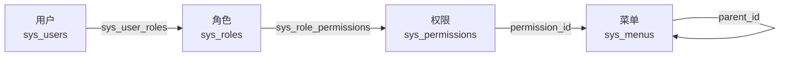

# MES RBAC 权限模型教程：用户、角色、菜单与接口鉴权

这是 MES MVP 的第二篇进阶教程，主题是 RBAC（Role-Based Access Control，基于角色的访问控制）。

第一篇教程解决了“项目怎么跑起来、前后端怎么通信”；这一篇解决一个更关键的问题：

> 登录成功以后，为什么有的人能看到“系统管理”，有的人看不到？为什么前端隐藏了按钮，后端还必须再拒绝一次越权请求？

学完这篇教程，你应该能够独立完成下面这条链路：

```text
用户登录
  → /me 返回角色、权限、数据范围和菜单树
  → 前端渲染侧边栏
  → 前端根据 button 权限隐藏按钮
  → 用户点击按钮
  → 后端 permission 中间件校验 API 权限
  → 有权限：执行业务
  → 无权限：返回 403
```

## 适合谁

- 已经读完 `docs/mes-mvp-tutorial.md`，知道项目如何登录和发请求；
- 知道 Laravel 路由、中间件、Eloquent 关联的基本概念；
- 想把“用户、角色、菜单、按钮、接口权限”真正串起来，而不是只做一个假的权限页面；
- 正在准备后台管理系统、MES、ERP、WMS 等需要 RBAC 的项目。

## 学习目标

完成教程后，你应当能够回答：

- 为什么权限不直接挂在用户身上，而要多一层角色？
- `sys_users`、`sys_roles`、`sys_permissions`、`sys_menus` 之间是什么关系？
- 菜单权限、页面权限、按钮权限、API 权限、数据权限分别解决什么问题？
- `/me` 为什么要返回菜单树，而不是前端写死菜单？
- `permission:system.users.index` 中间件是如何拒绝越权请求的？
- 为什么 `can()` 和 `<Can>` 只能改善体验，不能作为安全边界？
- 超级管理员为什么可以绕过权限检查？代码又如何防止别人随便授予超级管理员？
- `data_scope` 返回以后，为什么还需要在业务查询里做行级过滤？

## 0. RBAC 全景

### 0.1 四个核心对象



一句话解释：

- 用户不直接拥有权限，而是拥有角色；
- 角色拥有一组权限；
- 菜单通过 `permission_id` 绑定一个菜单权限；
- 前端根据权限决定“显示什么”，后端根据权限决定“允许做什么”。

### 0.2 五种权限类型

项目把权限分成五类：

| 类型 | 典型编码 | 作用 |
| --- | --- | --- |
| 菜单权限 | `menu.system` | 控制侧边栏分组或菜单根节点是否可见 |
| 页面权限 | `page.system.users` | 控制具体页面是否可达 |
| 按钮权限 | `button.system.users.create` | 控制新增、编辑、删除等按钮是否显示 |
| API 权限 | `system.users.create` | 控制后端接口是否允许调用 |
| 数据权限 | `data.scope.all`、`data.scope.factory`、`data.scope.line` | 描述用户可以看到的数据范围 |

注意两个容易混淆的点：

1. **按钮权限和 API 权限是两套编码。** 前端 `Can` 用 `button.*`，后端路由用不带 `button.` 的 API 编码。
2. **菜单权限和页面权限是两套编码。** `sys_menus.permission_id` 绑定的是 `menu.*` / `page.*`，用于生成 `/me` 的菜单树。

项目的 Seeder 会自动生成这些编码，避免手工维护时前后端写错。

### 0.3 权限检查的三个层次

一个后台系统至少要做三层检查：

```text
第一层：菜单是否可见
  由 /me 的 menus 决定，影响用户能不能在侧边栏看到入口

第二层：按钮是否显示
  由前端 can() / <Can> 决定，影响操作体验

第三层：接口是否允许
  由后端 permission 中间件决定，是真正的安全边界
```

只做第一层和第二层，用户仍然可以直接用 curl 调接口；所以第三层不能省。

## 1. 数据库模型

### 1.1 五张表

迁移文件在：

```text
database/migrations/2026_11_14_174006_create_rbac_tables.php
```

核心表：

| 表 | 作用 | 关键字段 |
| --- | --- | --- |
| `sys_users` | 用户 | `id`、`name`、`email`、`status` |
| `sys_roles` | 角色 | `id`、`code`、`name`、`status` |
| `sys_permissions` | 权限 | `id`、`code`、`name`、`type` |
| `sys_menus` | 菜单 | `id`、`parent_id`、`permission_id`、`path`、`sort` |
| `sys_user_roles` | 用户和角色的多对多关系 | `user_id`、`role_id` |
| `sys_role_permissions` | 角色和权限的多对多关系 | `role_id`、`permission_id` |

`sys_user_roles` 和 `sys_role_permissions` 使用联合主键，避免同一个用户重复绑定同一个角色、同一个角色重复绑定同一个权限。

### 1.2 User 模型

`app/Modules/System/Model/User.php`：

```php
public function roles(): BelongsToMany
{
    return $this->belongsToMany(Role::class, 'sys_user_roles', 'user_id', 'role_id');
}

public function activeRoles(): BelongsToMany
{
    return $this->roles()->where('status', true);
}
```

为什么还要有 `activeRoles()`？

因为“用户有角色”不代表“角色现在有效”。角色被停用后，它不应该继续授予权限。项目在权限计算时只使用 `activeRoles()`，停用角色会自动失效。

### 1.3 Role / Permission / Menu 模型

```php
// Role
public function permissions(): BelongsToMany
{
    return $this->belongsToMany(Permission::class, 'sys_role_permissions', 'role_id', 'permission_id');
}

// Permission
public function roles(): BelongsToMany
{
    return $this->belongsToMany(Role::class, 'sys_role_permissions', 'permission_id', 'role_id');
}

// Menu
public function parent(): BelongsTo
{
    return $this->belongsTo(self::class, 'parent_id');
}

public function children(): HasMany
{
    return $this->hasMany(self::class, 'parent_id')->orderBy('sort')->orderBy('id');
}
```

菜单是一个自关联树：

```text
系统管理
  ├── 用户管理
  ├── 角色管理
  └── 菜单管理
```

`Menu::toTree()` 把扁平列表按 `parent_id` 组装成前端需要的嵌套结构：

```php
public static function toTree(Collection $menus, ?int $parentId = null): array
{
    return $menus
        ->where('parent_id', $parentId)
        ->map(fn (self $menu) => [
            'id' => $menu->id,
            'parent_id' => $menu->parent_id,
            'permission_id' => $menu->permission_id,
            'name' => $menu->name,
            'path' => $menu->path,
            'icon' => $menu->icon,
            'sort' => $menu->sort,
            'children' => self::toTree($menus, $menu->id),
        ])
        ->values()
        ->all();
}
```

### 1.4 Seeder 如何准备演示数据

`database/seeders/SystemSeeder.php` 负责创建：

- 10 个角色；
- 22 个演示用户；
- 7 个部门；
- 菜单树；
- 菜单、页面、按钮、API、数据五类权限。

Seeder 使用 `updateOrCreate` 和 `sync`，所以重复执行不会无限增加数据。测试 `SystemSeederTest` 会验证：

- 重复 seeding 后角色、用户、权限、菜单数量不变；
- 超级管理员拥有全部菜单；
- 设备管理员只看到“首页驾驶舱”和“设备管理”；
- 车间主任的 `data_scope` 是 `line`；
- 质检主管有追溯权限，普通质检员没有。

本地初始化演示数据：

```bash
SEED_PASSWORD='your-demo-password' php artisan migrate --seed
```

生产环境不会在没有 `SEED_PASSWORD` 的情况下静默创建演示账号，这是 Seeder 的安全保护。

## 2. 后端：权限是怎么算出来的

所有权限计算集中在：

```text
app/Modules/System/Service/AccessControlService.php
```

### 2.1 取出用户的权限码

```php
public function permissionCodes(User $user): array
{
    $roles = $user->activeRoles()->get();

    if ($roles->contains('code', Role::SUPER_ADMIN)) {
        return Permission::query()->orderBy('code')->pluck('code')->all();
    }

    if ($roles->isEmpty()) {
        return [];
    }

    return Permission::query()
        ->whereHas('roles', fn ($query) => $query->whereKey($roles->modelKeys())->where('status', true))
        ->orderBy('code')
        ->pluck('code')
        ->all();
}
```

这段代码有三个关键点：

1. 只看启用角色；
2. 超级管理员直接返回所有权限；
3. 普通用户只返回“通过启用角色拿到的权限”。

### 2.2 单条权限判断

```php
public function allows(User $user, string $permissionCode): bool
{
    if ($this->isSuperAdmin($user)) {
        return true;
    }

    return in_array($permissionCode, $this->permissionCodes($user), true);
}
```

`allows()` 是后端鉴权的核心。它不关心权限来自哪个角色，只关心最终是否拥有这个权限码。

### 2.3 数据范围

```php
public function dataScope(User $user): string
{
    if ($this->isSuperAdmin($user)) {
        return self::SCOPE_ALL;
    }

    $granted = $this->permissionCodes($user);

    foreach ([self::SCOPE_ALL, 'data.scope.factory', 'data.scope.line'] as $code) {
        if (in_array($code, $granted, true)) {
            return substr($code, strlen('data.scope.'));
        }
    }

    return 'none';
}
```

返回值是：

| 返回值 | 含义 |
| --- | --- |
| `all` | 全部数据 |
| `factory` | 本工厂数据 |
| `line` | 本产线数据 |
| `none` | 没有数据权限，默认失败关闭 |

重要提醒：

> 当前项目已经把 `data_scope` 计算出来，并通过 `/me` 返回给前端；但**行级数据过滤还没有统一自动应用到所有业务查询**。如果要做“车间主任只能看本产线数据”，需要在对应 Service 查询中显式加 `production_line_id` 等条件。不要把 `data_scope` 误认为会自动隔离所有表。

### 2.4 生成菜单树

```php
public function menuTree(User $user, ?array $granted = null): array
{
    $granted ??= $this->permissionCodes($user);
    $permissions = Permission::query()->pluck('code', 'id');
    $menus = Menu::query()->orderBy('sort')->orderBy('id')->get();

    if ($this->isSuperAdmin($user)) {
        return Menu::toTree($menus);
    }

    $visible = $menus->filter(
        fn (Menu $menu) => $this->isReachable($menu, $menus, $permissions, $granted),
    );

    return Menu::toTree($visible);
}
```

`isReachable()` 的规则：

- 菜单绑定的权限码被授予 → 可见；
- 菜单自己没有权限，但它的某个子菜单可见 → 父菜单也保留；
- 叶子菜单没有可解析的权限，或权限记录不存在 → 对非超级管理员隐藏，默认失败关闭。

这解释了一个常见现象：用户没有“系统管理”根节点的单独授权，但只要他有“用户管理”子页面的权限，系统管理这个分组仍然会出现。

### 2.5 管理动作的防越权

权限系统不能只保护接口入口，还要保护管理动作。`AccessControlService` 提供了几条额外规则：

```php
public function ensureCanManageUser(User $actor, User $target): void
{
    if ($this->isSuperAdmin($target) && ! $this->isSuperAdmin($actor)) {
        throw new ApiException('只有超级管理员可以操作超级管理员账号', 403, status: 403);
    }
}
```

```php
public function ensureCanGrantRoles(User $actor, array $roleIds): void
{
    if ($roleIds === []) {
        return;
    }

    if (! $this->allows($actor, 'system.users.assign-roles')) {
        throw new ApiException('没有分配角色的权限', 403, status: 403);
    }

    if ($this->isSuperAdmin($actor)) {
        return;
    }

    if (Role::query()->whereKey($roleIds)->where('code', Role::SUPER_ADMIN)->exists()) {
        throw new ApiException('只有超级管理员可以授予超级管理员角色', 403, status: 403);
    }
}
```

这几条规则解决的是“接口有权限，但动作仍然越权”的问题：

- 有“新增用户”权限，不代表可以给新用户分配角色；
- 有“分配角色”权限，也不代表可以把 `super_admin` 授给别人；
- 普通管理员不能修改或停用超级管理员账号。

`RoleService::ensureCanGrantPermissions()` 还规定：非超级管理员不能创建/更新一个包含“自己没有的权限”的角色，防止通过造角色间接提权。

## 3. 后端：接口和中间件

### 3.1 路由上的权限声明

`routes/api.php` 给每个受保护接口单独挂权限：

```php
Route::get('/users', [UserController::class, 'index'])
    ->middleware('permission:system.users.index')
    ->name('users.index');

Route::post('/users', [UserController::class, 'store'])
    ->middleware('permission:system.users.create')
    ->name('users.store');

Route::put('/users/{user}/password', [UserController::class, 'resetPassword'])
    ->middleware('permission:system.users.reset-password')
    ->name('users.password');
```

整个路由组还包在：

```php
Route::middleware(['auth:sanctum', 'active'])->group(function (): void {
    // ...
});
```

于是三层中间件依次生效：

```text
auth:sanctum   → 有没有登录？
active         → 用户是否被停用？
permission:xxx → 有没有这个权限？
```

### 3.2 `permission` 中间件

实现位于 `app/Http/Middleware/EnsurePermission.php`：

```php
public function handle(Request $request, Closure $next, string $permission): Response
{
    $user = $request->user();
    $codes = array_filter(explode('|', $permission));
    $allowed = $user !== null
        && $codes !== []
        && collect($codes)->contains(
            fn (string $code): bool => $this->access->allows($user, $code),
        );

    abort_unless($allowed, 403, 'Forbidden.');

    return $next($request);
}
```

它支持 `a|b` 写法，表示满足任意一个权限即可。例如某些“列表或新增”共用的选项接口可以写成：

```php
->middleware('permission:quality.defects.index|quality.defects.create')
```

### 3.3 401、403、422 的区别

| 状态 | 含义 | 典型场景 |
| --- | --- | --- |
| 401 | 未认证 | 没带 Token、Token 失效、用户被停用 |
| 403 | 已认证但无权限 | 登录了，但没有 `system.users.index` |
| 422 | 参数校验失败 | 缺少邮箱、角色 ID 不存在 |
| 429 | 触发限流 | 登录失败次数过多、批量请求过快 |

前端看到 401 会清空登录态并回登录页；看到 403 应该提示“没有权限”，而不是把用户踢回登录页。

### 3.4 `/me` 返回什么

`MeController` 返回当前用户、启用角色、权限码、数据范围和菜单树：

```php
$user = $request->user()->load([
    'roles' => fn ($query) => $query->where('status', true),
    'employee',
]);
$permissions = $this->access->permissionCodes($user);

return ApiResponse::success([
    ...UserResource::make($user)->resolve(),
    'permissions' => $permissions,
    'data_scope' => $this->access->dataScope($user),
    'menus' => $this->access->menuTree($user, $permissions),
]);
```

这就是前端菜单、按钮和页面权限的唯一数据源。

### 3.5 系统管理接口一览

| 接口 | 权限 |
| --- | --- |
| `GET /api/v1/system/users` | `system.users.index` |
| `POST /api/v1/system/users` | `system.users.create` |
| `PUT /api/v1/system/users/{user}` | `system.users.update` |
| `PUT /api/v1/system/users/{user}/password` | `system.users.reset-password` |
| `PUT /api/v1/system/users/{user}/roles` | `system.users.assign-roles` |
| `GET /api/v1/system/roles` | `system.roles.index` |
| `POST /api/v1/system/roles` | `system.roles.create` |
| `PUT /api/v1/system/roles/{role}` | `system.roles.update` |
| `DELETE /api/v1/system/roles/{role}` | `system.roles.delete` |
| `GET /api/v1/system/permissions` | `system.permissions.index` |
| `GET /api/v1/system/menus` | `system.menus.index` |
| `POST /api/v1/system/menus` | `system.menus.create` |
| `PUT /api/v1/system/menus/{menu}` | `system.menus.update` |
| `DELETE /api/v1/system/menus/{menu}` | `system.menus.delete` |

### 3.6 用户管理里的业务保护

除了路由权限，`UserService` 还做了这些事情：

- 创建用户时，如果带了 `role_ids`，必须有 `system.users.assign-roles`；
- 不能停用当前登录账号；
- 只有超级管理员可以操作超级管理员账号；
- 重置密码后删除该用户的全部 Token，旧设备立即失效；
- 新增、编辑、重置密码、分配角色都会写操作日志。

重置密码后删除 Token 很关键：如果只改数据库密码，旧 Token 仍然可以继续访问，等于密码没有真正失效。

### 3.7 角色管理里的业务保护

`RoleService` 做了这些约束：

- `super_admin` 编码是系统保留的，不能通过 API 新建同名角色；
- 超级管理员角色不能停用、改编码或删除；
- 已分配给用户的角色不能删除；
- 非超级管理员不能授予自己没有的权限；
- 角色权限变更会写操作日志。

### 3.8 菜单管理里的业务保护

`MenuService` 的删除逻辑：

```php
public function delete(Menu $menu): void
{
    if ($menu->children()->exists()) {
        throw new ApiException('存在子菜单，不能删除', 403, status: 403);
    }

    $menu->delete();
}
```

菜单是树结构，直接删除父节点会让子节点变成孤儿，所以必须先删除叶子菜单。

前端菜单编辑页还会在“上级菜单”选择器里排除当前编辑分支，避免把菜单挂到自己的后代上导致循环。

## 4. 前端：菜单、按钮和路由守卫

### 4.1 `/me` 如何进入前端

登录后，`AdminLayout` 调用 `useCurrentUser()`，请求 `/me`：

```ts
const query = useQuery({
    queryKey: ['me'],
    queryFn: fetchMe,
    enabled: Boolean(token),
    staleTime: 30_000,
});

useEffect(() => {
    if (query.data) {
        setUser(query.data);
    }
}, [query.data, setUser]);
```

拿到 `menus` 后，侧边栏根据树结构渲染；拿到 `permissions` 后，按钮和页面操作使用 `can()` 判断。

### 4.2 `can()`：判断一个权限码

```ts
export function can(user: CurrentUser | null, code: string): boolean {
    return user?.permissions?.includes(code) ?? false;
}
```

用户还没加载时返回 `false`，这样不会先闪出无权限按钮再消失。

### 4.3 `<Can>`：控制按钮是否显示

```tsx
export default function Can({ code, children }: { code: string; children: ReactNode }) {
    const user = useAuthStore((state) => state.user);

    return can(user, code) ? children : null;
}
```

使用方式：

```tsx
<Can code="button.system.users.create">
    <Button type="primary">新增用户</Button>
</Can>
```

注意：`<Can>` 只是 UI 组件。它可以防止用户误点，但不能替代后端权限。即使前端把按钮藏起来，用户仍然可以手写请求调用接口。

### 4.4 菜单树和路由守卫

`utils/permission.ts` 提供三个基础函数：

```ts
can(user, code)        // 是否拥有权限码
findMenu(menus, path)  // 当前路径是否在用户菜单里
firstMenuPath(menus)   // 登录后应该落到哪个首页
```

`RequireAuth` 只检查 Token：

```tsx
function RequireAuth({ children }: { children: ReactNode }) {
    const token = useAuthStore((state) => state.token);

    return token ? children : <Navigate to="/login" replace />;
}
```

`MenuPage` 再检查路径是否在 `/me` 返回的菜单树里：

```tsx
const menu = findMenu(user.menus, pathname);

if (!menu) {
    return <Navigate to="/403" replace />;
}
```

为什么 Token 存在还要检查菜单？因为 Token 只能证明“登录过”，不能证明“这个用户现在还有某个页面的权限”。

`menuTrail()` 还处理了详情页路径：

```text
/system/users/12
```

会继承：

```text
/system/users
```

的菜单权限，但不会把 `/systematic` 误判成 `/system`，因为它按路径段边界匹配。

### 4.5 用户管理页

用户管理页把按钮权限和接口请求放在一起考虑：

```tsx
<Can code="button.system.users.create">
    <Button type="primary" onClick={() => setEditing({ mode: 'create' })}>
        新增用户
    </Button>
</Can>
```

角色下拉框只在有“分配角色”权限时加载：

```ts
const roles = useQuery({
    queryKey: ['system', 'roles'],
    queryFn: () => listRoles(),
    enabled: editing !== null && can(currentUser, 'button.system.users.assign-roles'),
});
```

这是一个很实用的细节：如果用户没有权限，就不要发一个注定返回 403 的请求，否则控制台会出现无意义的红色错误。

### 4.6 角色管理页

角色页把权限按类型分组：

```ts
const PERMISSION_TYPE_LABELS = {
    menu: '菜单权限',
    page: '页面权限',
    button: '按钮权限',
    api: '接口权限',
    data: '数据权限',
};
```

保存角色时提交 `permission_ids`：

```ts
return editing.mode === 'create'
    ? createRole(values)
    : updateRole(editing.role.id, values);
```

后端会把这些权限 ID 同步到 `sys_role_permissions`。

### 4.7 菜单管理页

菜单页负责维护：

- 菜单名称；
- 上级菜单；
- 路由路径；
- 图标；
- 绑定的菜单权限；
- 排序。

绑定的权限只显示 `type === 'menu'` 的权限，因为 `sys_menus.permission_id` 只应该指向菜单权限。页面权限和 API 权限由角色页单独勾选。

## 5. 完整例子：给“质检员”配一套权限

假设我们要创建一个只负责质量检验的角色。

### 第一步：确认权限码

Seeder 已经准备了质量相关权限，例如：

```text
menu.quality
page.quality.standards
page.quality.tasks
quality.standards.index
quality.inspections.index
quality.inspections.create
quality.inspections.record
quality.defects.index
button.quality.inspections.create
data.scope.line
```

### 第二步：创建角色

管理员先登录拿到 Token，再请求：

```http
POST /api/v1/system/roles
Authorization: Bearer <admin-token>
Content-Type: application/json
```

```json
{
  "code": "quality_inspector_custom",
  "name": "质检员（自定义）",
  "description": "只能做质量检验",
  "status": true,
  "permission_ids": [1, 2, 3]
}
```

实际使用时，`permission_ids` 从 `GET /api/v1/system/permissions` 获取，不要手写猜测。

### 第三步：创建用户或分配角色

```http
PUT /api/v1/system/users/{user_id}/roles
Authorization: Bearer <admin-token>
Content-Type: application/json
```

```json
{
  "role_ids": [<quality_role_id>]
}
```

### 第四步：新用户登录并查看 `/me`

新用户登录后，`/me` 会返回：

```json
{
  "permissions": [
    "menu.quality",
    "page.quality.tasks",
    "quality.inspections.index",
    "button.quality.inspections.create",
    "data.scope.line"
  ],
  "data_scope": "line",
  "menus": [
    {
      "name": "质量管理",
      "children": [
        {
          "name": "检验任务",
          "path": "/quality/tasks"
        }
      ]
    }
  ]
}
```

前端只渲染“质量管理”及其子菜单，按钮根据 `button.*` 权限显示。

### 第五步：验证越权被拒绝

即使用户手动请求用户列表：

```bash
curl -i http://mes.test/api/v1/system/users \
  -H 'Accept: application/json' \
  -H 'Authorization: Bearer <quality-user-token>'
```

也会得到：

```json
{
  "code": 403,
  "message": "Forbidden.",
  "data": null,
  "timestamp": 1760000000
}
```

这正是后端权限中间件在起作用，而不是前端隐藏按钮的功劳。

## 6. 新增一个受权限保护的接口

以后给项目加功能时，按这个顺序做，权限才不会漏。

### 第一步：定义权限码

在 `SystemSeeder` 的 API 权限表中增加一个编码，例如：

```php
'reports.daily.export' => '导出生产日报',
```

Seeder 会同时生成：

```text
reports.daily.export          // API 权限
button.reports.daily.export  // 按钮权限
```

### 第二步：给路由挂中间件

```php
Route::get('/reports/daily/export', [ReportController::class, 'export'])
    ->middleware('permission:reports.daily.export')
    ->name('reports.daily.export');
```

### 第三步：给角色分配权限

在角色管理页勾选“导出生产日报”，或者在 Seeder 的角色定义中加入该权限。

### 第四步：前端加按钮权限

```tsx
<Can code="button.reports.daily.export">
    <Button>导出日报</Button>
</Can>
```

### 第五步：写测试

至少覆盖：

- 不带 Token → 401；
- 带 Token 但没有权限 → 403；
- 带 Token 且有权限 → 200；
- 参数错误 → 422。

可以参考：

```text
tests/Feature/Api/UserControllerTest.php
tests/Feature/Api/RoleControllerTest.php
tests/Feature/Api/MenuManagementTest.php
tests/Feature/Api/PermissionControllerTest.php
```

## 7. 测试与验收

### 7.1 运行 RBAC 相关测试

```bash
php artisan test --compact tests/Feature/Api/UserControllerTest.php
php artisan test --compact tests/Feature/Api/RoleControllerTest.php
php artisan test --compact tests/Feature/Api/MenuManagementTest.php
php artisan test --compact tests/Feature/Api/PermissionControllerTest.php
php artisan test --compact tests/Feature/SystemSeederTest.php
```

### 7.2 前端权限测试

```bash
cd frontend/web
npm test -- src/utils/permission.test.ts
npm run types:check
```

### 7.3 手工验收清单

- 超级管理员登录后能看到全部 10 个菜单根节点；
- 设备管理员只看到首页驾驶舱和设备管理；
- 车间主任的 `/me` 中 `data_scope` 为 `line`；
- 普通质检员没有追溯菜单；
- 无权限用户直接请求 `/api/v1/system/users` 返回 403；
- 停用用户不能登录；
- 停用用户之前拿到的 Token 也不能继续使用；
- 重置密码后旧 Token 失效；
- 已分配用户的角色不能删除；
- 有子菜单的菜单不能删除；
- 非超级管理员不能授予超级管理员角色；
- 非超级管理员不能创建包含自己没有的权限的角色。

## 8. 常见坑

| 现象 | 原因 | 处理 |
| --- | --- | --- |
| 菜单不显示 | 菜单没有绑定权限，或角色没有 `menu.*` / `page.*` | 检查 `sys_menus.permission_id` 和角色权限 |
| 菜单显示了但接口 403 | 只有菜单权限，没有对应 API 权限 | 给角色补 `system.*`、`quality.*` 等 API 权限 |
| 按钮不显示 | 缺少 `button.*` 权限 | 检查前端 `Can` 的编码和后端 Seeder |
| 按钮显示了但接口 403 | 前端权限码和后端权限码不一致 | 统一使用 Seeder 生成的编码 |
| 用户登录后菜单为空 | 角色被停用、用户没有角色、`/me` 请求失败 | 查看用户角色、角色状态和 Network |
| 改了角色权限但页面没变化 | `/me` 有 30 秒缓存，或页面未刷新 | 刷新页面、重新登录，或等待缓存过期 |
| 停用用户还能访问 | 只改了用户状态，没有 `active` 中间件 | 确认路由组有 `active`，并重新请求 |
| 重置密码后旧 Token 还能用 | 没有删除 Token | 确认 `resetPassword()` 执行了 `$user->tokens()->delete()` |
| 删除角色 403 | 角色仍分配给用户 | 先解除用户角色，再删除 |
| 删除菜单 403 | 菜单还有子菜单 | 先删除叶子菜单 |
| `data_scope` 有了但仍看到全部数据 | 只返回了范围，没有在查询里过滤 | 在 Service 查询中显式加范围条件 |
| 非超级管理员能授出超级管理员 | 缺少 `ensureCanGrantRoles()` 保护 | 检查角色分配入口是否调用了访问控制服务 |

## 9. 设计取舍

这套 RBAC 有几个值得学习的取舍。

### 9.1 为什么权限码放在数据库，而不是写成 PHP Enum？

权限会随着业务页面增加而增加。放在数据库里，管理员可以通过角色管理页动态调整；如果写成 Enum，每加一个权限都要改代码、发版。

代价是 Seeder、路由中间件、前端 `Can` 三处必须保持编码一致。项目用 Seeder 统一生成编码，减少手写错误。

### 9.2 为什么菜单也要绑定权限？

菜单是用户看到系统的第一层入口。把菜单和权限绑定后，`/me` 可以只返回用户能访问的菜单树，前端不需要自己维护一份角色判断逻辑。

### 9.3 为什么超级管理员要绕过检查？

超级管理员是系统的“逃生舱”：当权限配置错误时，仍然需要有人能进入系统修复。绕过检查只应该给一个受保护的角色，并且代码要限制这个角色的创建、改名、停用和授予。

### 9.4 为什么前端隐藏按钮不算安全？

前端代码运行在用户浏览器里，用户可以修改 JavaScript、复制请求、用 curl 调用接口。真正的安全边界永远是后端中间件和业务校验。

## 10. 练习

### 练习 1：只给用户看板权限

创建一个角色，只授予：

```text
menu.dashboard
page.dashboard.overview
dashboard.overview
data.scope.factory
```

验收：

- 登录后只看到“首页驾驶舱”；
- 直接访问 `/system/users` 跳转 403；
- 直接请求 `/api/v1/system/users` 返回 403；
- `/me` 的 `menus` 只有驾驶舱分支。

### 练习 2：给“设备管理员”增加导出按钮

新增一个 API 权限和按钮权限，完成：

- 后端路由加 `permission`；
- Seeder 给设备管理员授权；
- 前端用 `<Can>` 包住按钮；
- 写 401 / 403 / 200 三类测试。

### 练习 3：限制车间主任的数据范围

以 `workshop_director` 为例，尝试在某个列表 Service 中加入产线过滤：

```php
if ($this->access->dataScope($user) === 'line') {
    $query->where('production_line_id', $user->employee?->production_line_id);
}
```

验收：

- 车间主任只能看到本产线数据；
- 超级管理员仍然能看到全部；
- 没有 `data.scope.line` 的用户不会意外看到全部数据。

注意：这是一个练习方向，不要直接把示例条件复制到所有表；不同业务表关联产线的方式不同。

## 11. 术语表

| 术语 | 解释 |
| --- | --- |
| RBAC | 基于角色的访问控制 |
| 权限码 | 用字符串表示的权限标识，例如 `system.users.create` |
| 菜单权限 | 控制侧边栏节点是否可见的权限 |
| 页面权限 | 控制具体页面是否可达的权限 |
| 按钮权限 | 控制操作按钮是否显示的权限 |
| API 权限 | 控制后端接口是否允许调用的权限 |
| 数据权限 | 控制用户能看到多大范围数据的权限 |
| 超级管理员 | 绕过权限检查的受保护角色 |
| 失败关闭 | 权限缺失时默认拒绝，而不是默认放行 |
| 幂等 Seeder | 重复执行不会重复创建数据的 Seeder |

## 12. 下一步

建议继续阅读：

- `app/Modules/System/Service/AccessControlService.php`：权限计算中心；
- `app/Http/Middleware/EnsurePermission.php`：接口鉴权入口；
- `tests/Feature/Api/UserControllerTest.php`：用户管理的越权测试；
- `tests/Feature/Api/RoleControllerTest.php`：角色提权测试；
- `tests/Feature/SystemSeederTest.php`：不同角色的菜单和数据范围；
- `frontend/web/src/utils/permission.ts`：菜单和按钮权限工具。

学 RBAC 最有效的方法不是背表结构，而是亲手做一个“新角色”：给它勾权限、创建用户、登录、观察菜单变化、再手动调用一个没有权限的接口确认 403。把这套闭环走通，你就能把 RBAC 用到自己的后台项目里。
