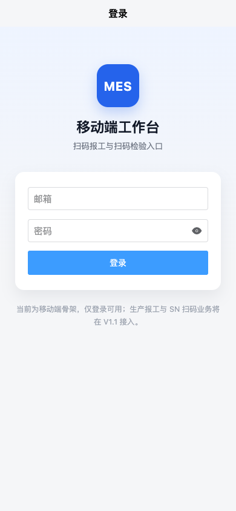
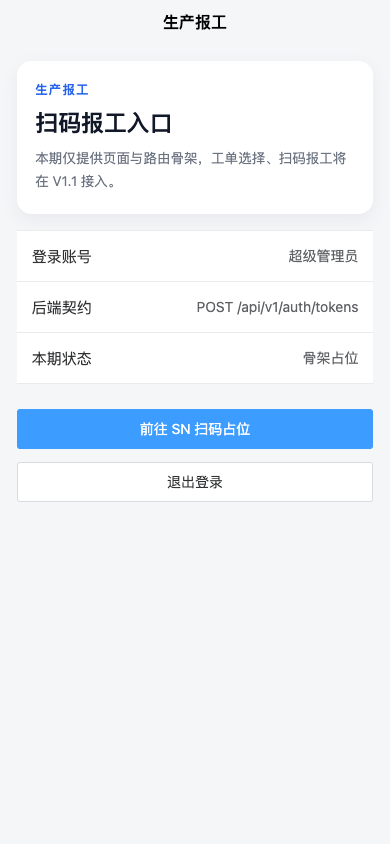
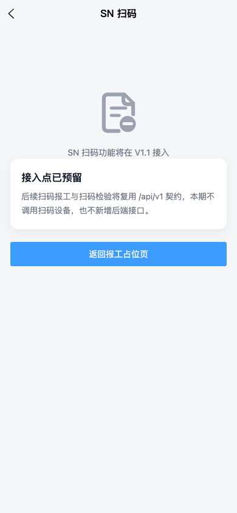

# MES 移动端

[简体中文](#mes-移动端) | [English](#mes-mobile)

UniApp + Vue 3 + TypeScript + uView Plus 的移动端工程骨架。

## 本期范围

本期只搭工程骨架，不实现移动端业务功能：

- 登录：可用，复用 `POST /api/v1/auth/tokens`，用于验证请求层与登录态。
- 生产报工：页面与路由占位，工单选择、扫码报工在 V1.1 接入。
- SN 扫码：页面与路由占位，扫码设备与业务接口在 V1.1 接入。
- 不新增后端接口，移动端与 Web 端共用同一套 `/api/v1` 契约。

## 页面与路由

| 页面 | 路径 |
| --- | --- |
| 登录 | `pages/login/index` |
| 生产报工占位 | `pages/production/report/index` |
| SN 扫码占位 | `pages/production/scan/index` |

## 页面预览

以下截图来自本地 H5（390 × 844），覆盖当前 3 个页面：

| 登录 | 生产报工 | SN 扫码 |
| --- | --- | --- |
|  |  |  |

## 开发与构建

```bash
cd frontend/mobile
npm install
npm run dev:h5       # H5 开发，端口 15174，/api 代理到 http://mes.test
npm run dev:app      # App 开发资源，使用 HBuilderX 运行
npm run typecheck
npm run test
npm run build:h5     # 独立构建 H5 产物到 dist/build/h5
npm run build:app    # 构建 App 资源到 dist/build/app
```

H5 与 App 资源构建均已通过。App 产物需要用 HBuilderX 导入 `dist/build/app` 运行；正式发布前再配置 `manifest.json` 的 appid。小程序平台尚未接入依赖。

## 请求层与登录态

请求层位于 `src/api/request.ts`，统一解析 `{ code, message, data, timestamp }`，自动注入 `Authorization: Bearer <token>`。

Token 存在 `uni` 本地存储的 `mes.mobile.token`；应用启动时 `restoreSession()` 读取 Token 并调用 `GET /api/v1/me` 恢复用户信息。

接口返回 `401` 时清理本地登录态并重定向到登录页。

H5 开发环境留空 `VITE_API_URL` 即可走 Vite 代理；App、真机或独立部署时通过环境变量设置绝对地址，例如 `VITE_API_URL=http://mes.test/api/v1`。

## 后续接入点

生产报工与 SN 扫码页面已预留路由和导航入口，后续只需在对应页面接入扫码能力与现有 `/api/v1` 业务接口，不需要调整工程结构。

---

# MES Mobile

[简体中文](#mes-移动端) | [English](#mes-mobile)

A mobile project skeleton built with UniApp, Vue 3, TypeScript, and uView Plus.

## Scope

This iteration only establishes the project skeleton; no mobile business features are implemented yet:

- Login: available. It reuses `POST /api/v1/auth/tokens` to verify the request layer and session handling.
- Production reporting: page and route placeholder. Work-order selection and scan-to-report will be added in V1.1.
- SN scanning: page and route placeholder. Scanning devices and business APIs will be added in V1.1.
- No new backend APIs. Mobile and Web share the same `/api/v1` contract.

## Pages and Routes

| Page | Path |
| --- | --- |
| Login | `pages/login/index` |
| Production report placeholder | `pages/production/report/index` |
| SN scan placeholder | `pages/production/scan/index` |

## Page Preview

The screenshots below were captured from the local H5 build at 390 × 844 and cover all 3 current pages:

| Login | Production Report | SN Scan |
| --- | --- | --- |
|  |  |  |

## Development and Build

```bash
cd frontend/mobile
npm install
npm run dev:h5       # H5 development on port 15174; /api proxies to http://mes.test
npm run dev:app      # App development assets; run with HBuilderX
npm run typecheck
npm run test
npm run build:h5     # Build standalone H5 assets into dist/build/h5
npm run build:app    # Build App assets into dist/build/app
```

Both the H5 and App asset builds pass. Import `dist/build/app` into HBuilderX to run the App build; configure the `manifest.json` appid before an official release. Mini-program dependencies are not integrated yet.

## Request Layer and Session

The request layer lives in `src/api/request.ts`. It normalizes the `{ code, message, data, timestamp }` response shape and automatically injects `Authorization: Bearer <token>`.

The token is stored in `uni` local storage under `mes.mobile.token`. On startup, `restoreSession()` reads the token and calls `GET /api/v1/me` to restore the user profile.

A `401` response clears the local session and redirects to the login page.

Leave `VITE_API_URL` empty during H5 development to use the Vite proxy. For App builds, physical devices, or standalone deployments, set an absolute URL through the environment variable, for example `VITE_API_URL=http://mes.test/api/v1`.

## Next Integration Points

The production report and SN scan pages already have routes and navigation entries. Future work only needs to connect scanning capabilities and the existing `/api/v1` business APIs on those pages; no project structure changes are required.
